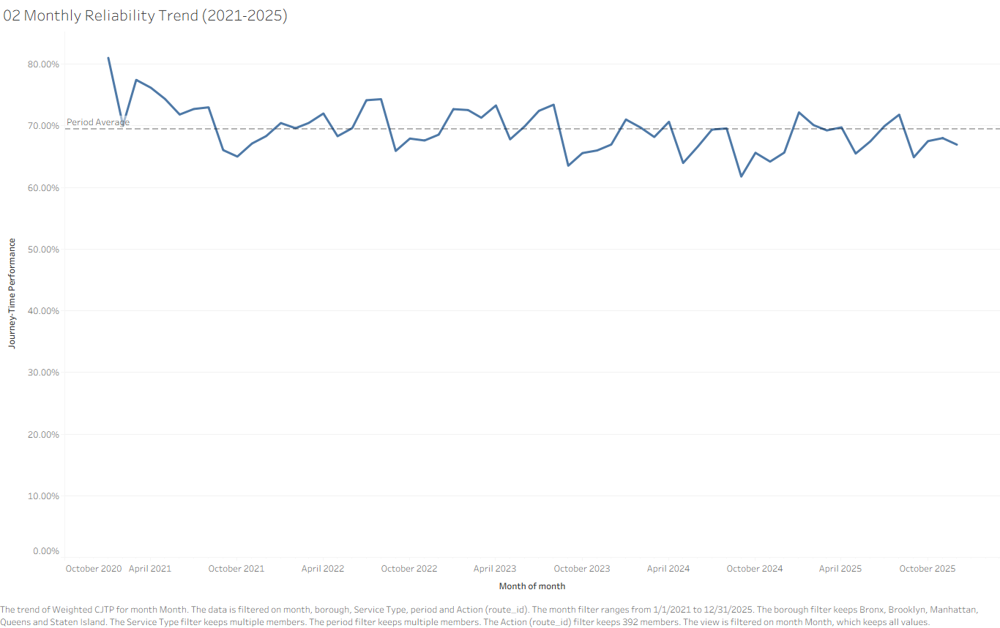
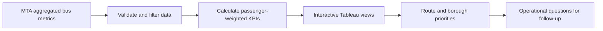
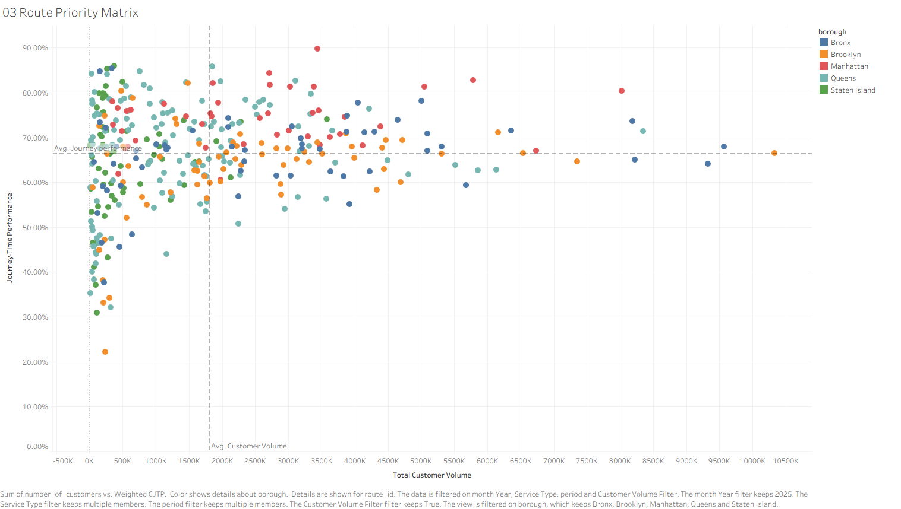
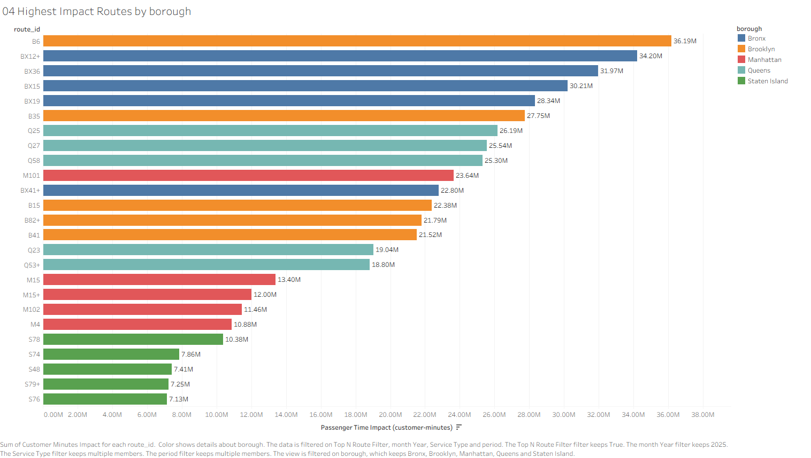
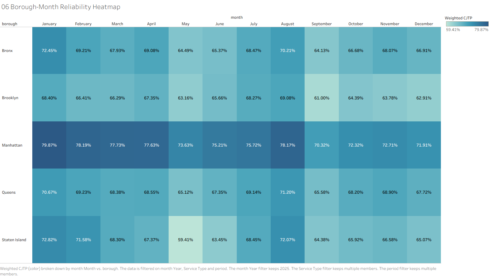
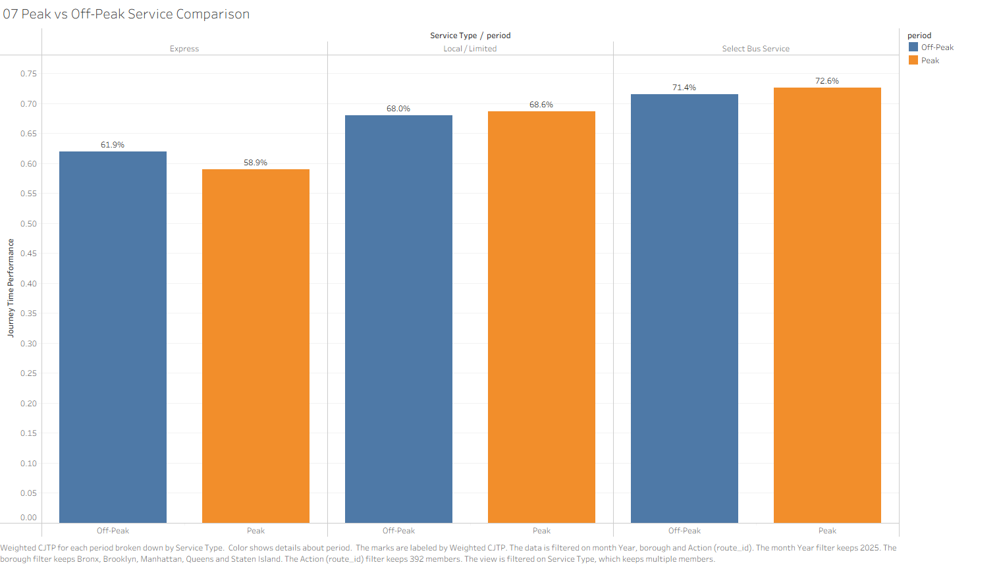

# Urban Mobility & Public Transport Performance | Tableau

**An interactive, passenger-focused analysis of New York City's bus network reliability, journey-time performance, and operational priorities.**

**Academic project · September 2026**  
**Tools:** Tableau · Calculated Fields · Parameters · Dashboard Actions · Data Cleaning · KPI Reporting · Transportation Analytics

> **Research question:** Which routes, boroughs, periods, and service types should receive operational attention when both service reliability and passenger exposure are considered?

## Project at a glance

| Dataset / scope | Result |
|---|---|
| Source | MTA Bus Customer Journey-Focused Metrics: Beginning 2017 (New York State Open Data) |
| Valid observations after filtering | **67,252** (from 67,253 source records) |
| Dataset time coverage | August 2017 – May 2026; analysis focuses on **2025** |
| Reported customer volume, 2025 | **~642.6 million** (not unique individual passengers) |
| Active routes, 2025 | **356** |
| Customer-weighted journey-time performance, 2025 | **68.5%** |
| Weighted additional journey time, 2025 | **3.31 minutes** |
| Routes flagged as high-demand / below-average reliability | **47** |



## 1. Business problem

Network-wide averages can hide reliability problems experienced by large numbers of passengers. A poorly performing low-volume route and a modestly delayed high-volume route may have very different network-wide consequences.

This Tableau project examines public-transport performance at **route, borough, month, service type, and peak/off-peak period** levels. Its aim is to support *operational prioritisation*—identifying where further review is most worthwhile—rather than simply ranking the worst reliability percentages.

The main analytical dimensions were:

- **Reliability:** Customer Journey Time Performance (CJTP), or the share of customers whose journey was completed within five minutes of scheduled time.
- **Delay exposure:** Additional Bus Stop Time and Additional Travel Time.
- **Passenger impact:** Additional Journey Time multiplied by reported customer volume.
- **Segmentation:** Routes, boroughs, months, service types, and peak/off-peak periods.

## 2. Data preparation and quality checks

The source is the **MTA Bus Customer Journey-Focused Metrics: Beginning 2017** dataset, published by the Metropolitan Transportation Authority through New York State Open Data.

Its observations are **aggregated route-month/service-segment records**, not individual trips. The source extract contained **67,253 rows and nine variables** spanning August 2017 to May 2026. After reviewing field types, missingness, duplicate records, and anomalous values:

- No duplicate records were identified.
- One record with an `UNKNOWN` borough, missing CJTP, and an anomalous `-30` minute additional-time value was excluded with a Tableau data-source filter.
- **67,252 records** remained for analysis, representing five New York City boroughs.
- Service-type codes were converted to readable labels: **Express**, **Local / Limited**, and **Select Bus Service**.
- Missing April–August 2020 records and the partial years 2017 and 2026 were retained as known coverage limitations.

The primary dashboard view focuses on **2025**, with a separate historical reliability trend for **2021–2025**.

## 3. Analysis and dashboard design



### Passenger-weighted measures

To avoid treating a low-volume service segment as equivalent to a high-volume one, network performance uses **customer-volume-weighted averages**.

**Weighted Journey Time Performance**

```text
SUM([Number_of_customers] * [customer_journey_time_performance])
/
SUM([Number_of_customers])
```

**Additional Journey Time**

```text
[additional_bus_stop_time] + [additional_travel_time]
```

**Customer Minutes Impact**

```text
[Number_of_customers] * [Additional Journey Time]
```

*Customer Minutes Impact is an aggregate exposure indicator from the available service-segment data; it is not a measurement of each passenger's actual experienced delay.*

### Interactive functionality

The report documents **15 calculated fields** and **four parameters**:

| Parameter | Purpose |
|---|---|
| **KPI Selector** | Switch the headline metric between volume, reliability, additional time, and active routes |
| **Borough Metric Selector** | Choose the measure used in borough comparisons |
| **Top N Routes per Borough** | Set the number of high-impact routes shown per borough |
| **Minimum Route Volume** | Exclude low-volume routes from the priority matrix |

The seven analysis views include a KPI Index, historical reliability trend, route priority matrix, passenger-impact ranking, borough comparison, borough–month heatmap, and peak/off-peak service comparison. Year, borough, service type, and period filters support exploration, while dashboard **filter and highlight actions** connect the views. Selected filters deliberately do not affect certain comparisons, so they preserve the intended analytical context.

### Visual examples

**Route Priority Matrix:** highlights routes with relatively high passenger volume and below-average weighted reliability. Dotted reference lines are averages of displayed routes, **not official MTA service targets**.



**Highest passenger time impact:** combines service volumes with additional journey time to identify heavily affected routes.



**Borough and month heatmap:** examines geographic and temporal differences in weighted reliability.



## 4. Key findings

All findings below are from the report's **2025 default dashboard view**, unless noted otherwise.

### Network reliability and delay composition

- **Weighted CJTP:** **68.5%**, across approximately **642.6 million reported customer-volume units** and **356 active routes**.
- **Weighted Additional Journey Time:** **3.31 minutes**, consisting of **2.56 minutes of extra bus-stop time** and **0.75 minutes of extra in-vehicle travel time**.
- Thus, approximately **77%** of measured additional journey time was associated with **bus-stop waiting**, pointing toward a useful subject for follow-up investigation.
- The historical annual CJTP was **71.7% in 2021**, fell to **67.3% in 2024**, and recovered modestly to **68.5% in 2025**—still below the 2021 level.

### Routes with substantial passenger exposure

The route priority matrix identified **47 routes** in the high-demand / below-average reliability quadrant. Examples include:

| Route | Reported 2025 customer volume | Weighted CJTP |
|---|---:|---:|
| BX12+ | 9.32 million | 64.1% |
| BX15 | 5.68 million | 59.3% |
| Q25 | 6.13 million | 62.8% |

The complementary passenger-time-impact analysis identified:

| Route | Approx. customer minutes of impact |
|---|---:|
| B6 | 36.19 million |
| BX12+ | 34.20 million |
| Q25 | 26.19 million |

A route can generate high aggregate passenger impact without being the route with the lowest reliability percentage. **Demand and delay severity need to be considered together.**

### Differences across boroughs and service types

- **Manhattan:** highest 2025 weighted CJTP (**75.1%**) and lowest weighted additional journey time (**2.30 minutes**).
- **Brooklyn:** lowest weighted CJTP (**65.5%**) and highest weighted additional journey time (**3.77 minutes**).
- **Queens:** largest reported customer volume (**184.8 million**) with **68.3%** weighted CJTP.
- **Express services:** lowest CJTP, at **58.9% peak** and **61.9% off-peak**.
- **Select Bus Service:** highest among compared service categories, at **72.6% peak** and **71.4% off-peak**.



In the 2025 borough–month heatmap, **Staten Island in May (59.4%)** and **Brooklyn in September (61.0%)** showed particularly weak monthly values. May, September, and December appeared comparatively weaker in several historical views, but this does **not establish long-term seasonality or causal drivers**.

## 5. Interpretation and potential operational uses

The dashboard provides an evidence-based way to select follow-up questions:

1. **Investigate high-demand, low-reliability routes first**, considering both CJTP and customer minutes impact.
2. **Examine additional bus-stop time** in greater detail because it dominates the reported additional journey-time measure.
3. **Compare boroughs and service types** before applying network-wide interventions.
4. **Monitor temporal patterns**, then seek operational records for incident, traffic, schedule, and frequency explanations.

These are **investigation priorities, not proven causes or guaranteed improvement measures**.

## 6. Limitations

- The data are aggregated by route/month/service segment, not individual journeys or specific stops.
- Reported customer volume **does not represent unique passengers**.
- Explanatory variables such as traffic, weather, roadworks, frequency, and timetable adherence are unavailable in this dataset.
- The dashboard's reference lines are **relative sample benchmarks**, not official service standards.
- Missing months in 2020 and partial edge years affect longitudinal interpretation.
- The findings are **descriptive**, not causal, and the project does **not** build a delay-prediction model.

Future extensions could incorporate operational incident logs, weather, schedules, and service-frequency data to investigate the mechanisms behind the observed performance gaps.

## 7. Explore the workbook

The original project was developed in **Tableau** as part of the *Visualization and Story Telling using Tableau* coursework in 2026.

- Download the .twbx file and open it using a compatible Tableau Desktop installation.
- Use **KPI Selector**, **Borough Metric Selector**, **Top N Routes per Borough**, and **Minimum Route Volume** to explore different operational perspectives.
- Note that the screenshots in [`assets/`](assets/) are exported from the submitted academic report and document the reported results.

**Reproducibility note:** This README is based on the submitted academic report. It describes the documented calculations and observations; no independent audit of the underlying Tableau workbook was performed for this README.

## 8. References and attribution

- **Data source:** Metropolitan Transportation Authority, *MTA Bus Customer Journey-Focused Metrics: Beginning 2017*, New York State Open Data (cited in the academic report, 2026).
- **Methodology and findings:** *Exploring Urban Mobility and Public Transport Performance using Tableau*, academic assignment, September 2026.
- Additional methodological references are listed in the accompanying academic report, including Lunke (2020), Li and Tan (2020), and Munzner (2014).

---

**Project by Mustafa Efe Yakın** · MSc Data Analytics ·
